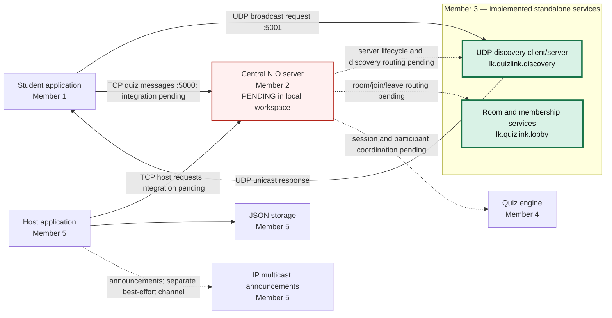
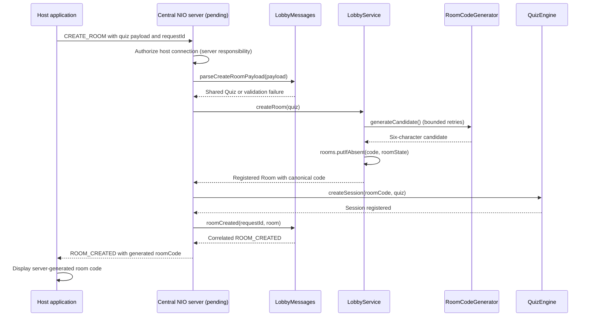
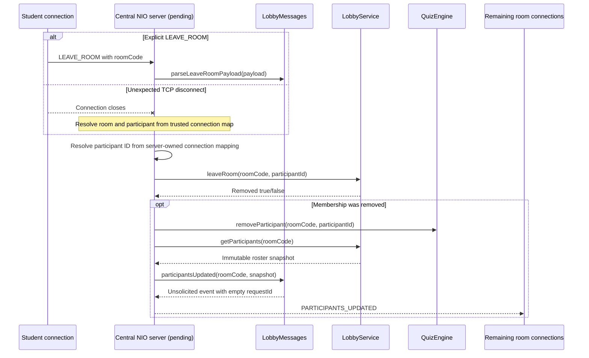

# Member 3: UDP discovery and lobby

QuizLink is a Java 17 LAN quiz and polling platform. Member 3 implements reusable UDP server
discovery and the in-memory room and participant services. The module uses Core Java networking,
Gson, shared project protocol/models, and JUnit 5 tests. It does not implement the central TCP
server, Swing UI integration, quiz execution, persistence, or multicast announcements.

## Responsibilities

Member 3 owns `lk.quizlink.discovery` (UDP discovery) and `lk.quizlink.lobby` (rooms and
participants). Stages 4-6 implement the reusable UDP discovery server and client; Stages 7-8
provide in-memory room-code generation, room management, and participant membership.
Disconnect cleanup is exposed as a lobby operation for the server integration to invoke.
Student UI integration remains future work.

## UDP discovery protocol

The client sends the exact UTF-8 datagram `QUIZLINK_DISCOVER_V1` to UDP port `5001`. A valid
request receives a unicast JSON datagram at the request's source IP address and source UDP
port:

```json
{"service":"QuizLink","version":1,"tcpPort":5000}
```

The service and version are fixed by the agreed protocol; the TCP port comes from
`ProtocolConstants.TCP_PORT` by default. The server does not put an IP address in the response:
the future client should use the response packet's source address. Invalid or oversized
datagrams receive no response. A discovery response only identifies an advertised TCP
endpoint; it does not establish TCP connectivity or join a room.

## Implemented API and classes

`UdpDiscoveryServer` is an `AutoCloseable` background service:

- `UdpDiscoveryServer()` uses the shared UDP and TCP ports.
- `UdpDiscoveryServer(int listeningPort, int advertisedTcpPort)` configures ports; UDP port
  zero requests an ephemeral listening port for tests.
- `start()` binds the wildcard local address and starts the listener thread. It reports bind
  errors to the caller.
- `stop()` closes the socket and waits for the listener thread to finish. It is idempotent.
- `isRunning()` reports listener state.
- `getBoundPort()` returns the actual bound port while running.
- `close()` delegates to `stop()`.

Starting an already-running instance and stopping an already-stopped instance are harmless.
An instance can be restarted after `stop()` returns. Invalid listening or advertised TCP ports
are rejected by the constructor.

`DiscoveryServerDemo` is a standalone UDP-only demonstration entry point. From PowerShell in
the repository root, run:

```powershell
mvn compile exec:java "-Dexec.mainClass=lk.quizlink.discovery.DiscoveryServerDemo"
```

It reports the actual UDP port and advertised TCP port. It does not start the central TCP
server. Press Ctrl+C to invoke its shutdown hook and close the UDP service.

## Socket lifecycle and error handling

The socket binds to the wildcard local address to receive local and LAN requests. A dedicated
daemon thread blocks in `DatagramSocket.receive`, so neither the caller nor a future NIO
Selector thread is blocked. The receive buffer is bounded; request length and UTF-8 content
must exactly match the agreed request. Reused receive packets have their length reset before
each read. Closing the socket unblocks receive, and expected shutdown closure is not logged as
an error. A bind error is thrown by `start()`; unexpected listener I/O failures are logged and
clear the running state.

Malformed network requests are ignored without noisy logging or responses. This is a trusted
LAN demonstration protocol, not an authenticated or encrypted service.

## UDP discovery client (Stage 5)

`UdpDiscoveryClient` sends the exact UTF-8 request and accepts only a valid response object with
string `service: "QuizLink"`, integer `version: 1`, and integer `tcpPort` in the range 1-65535.
The advertised server IP is taken from the response datagram's source address, never from a
JSON address field. Invalid, malformed, unsupported, truncated, or oversized responses are
ignored. A successful discovery result does not authenticate the server or prove its TCP
service is reachable.

The immutable `DiscoveryResult(InetAddress serverAddress, int tcpPort)` holds the endpoint;
`serverIpAddress()` returns the numeric address string without a hostname lookup.

Public client constructors and method:

- `UdpDiscoveryClient()` uses the default UDP port and a 1.5-second timeout with LAN broadcast.
- `UdpDiscoveryClient(int discoveryPort, Duration timeout)` configures broadcast discovery.
- `UdpDiscoveryClient(InetAddress destination, int discoveryPort, Duration timeout)` sends to
  one configured unicast destination, useful for loopback tests.
- `Optional<DiscoveryResult> discover() throws IOException` returns the first valid response,
  or `Optional.empty()` when the overall deadline expires; unexpected socket and send failures
  are reported as `IOException`.

Broadcast mode gathers unique IPv4 broadcast addresses from active, non-loopback network
interfaces and also sends to `255.255.255.255` as a fallback. Destinations are deduplicated.
Unavailable interfaces are skipped. The socket enables broadcast and binds an ephemeral local
port. This strategy covers ordinary Wi-Fi and Ethernet adapters without hardcoding a host IP;
virtual adapters may also be included when they are up and expose a broadcast address.

Each `discover()` call owns and closes its socket and applies one monotonic overall deadline.
The first valid response wins if multiple servers answer; there is no server-selection policy
or authentication in the current team protocol. The timeout is configurable and defaults to
1.5 seconds. Callers must not run this blocking operation on Swing's Event Dispatch Thread.

Example synchronous use (run from a worker thread):

```java
Optional<DiscoveryResult> found = new UdpDiscoveryClient().discover();
found.ifPresent(result -> System.out.println(
        result.serverIpAddress() + ":" + result.tcpPort()));
```

Future Student UI integration should perform the blocking `discover()` call on a background
executor, keep manual host entry available after an empty result or `IOException`, and dispatch
any Swing view update through the EDT. The current `StudentClientController` does not expose
discovery-specific UI methods; no such methods are implied here. It accepts a host string through
`connectAndJoin(String, StudentJoinRequest)` and uses TCP port 5000 by default. Integrating a
non-default `DiscoveryResult.tcpPort()` requires a separately agreed Student-side API change.
No Student application files were changed for discovery.
Windows Firewall rules and LAN isolation can prevent broadcast requests or replies. Do not
disable the firewall or alter network configuration as part of the application. Discovery is
for a trusted LAN demonstration and responses are not authenticated.

## Automated tests

`UdpDiscoveryServerTest` uses loopback UDP and ephemeral ports to exercise startup, exact
request/response JSON, unicast return to the client's source port, invalid and oversized
requests, continued service after invalid packets, multiple clients, socket release, restart,
port validation, and bind failure.

`UdpDiscoveryClientTest` verifies client/server interoperability, exact request bytes,
configurable unicast destination, response source address and advertised port, bounded
no-response timeout, strict response validation (including wrong types, missing/null fields,
unsupported versions, invalid ports and trailing data), invalid-then-valid handling,
oversized replies, deadline behavior during invalid-packet traffic, first-valid-response
selection, repeated calls, and result/configuration validation. Tests use loopback sockets,
ephemeral ports, and bounded timeouts; they require no external network or LAN configuration.

## Future integration requirements

- Member 2 should start `UdpDiscoveryServer` only after the central TCP server is successfully
  listening, and stop it as part of central server shutdown.
- Start/stop calls must happen outside the NIO Selector thread; the service's own listener
  thread performs blocking UDP receives.
- Member 1 should integrate a future UDP discovery client with the Student Swing interface.
  Discovery must run outside Swing's Event Dispatch Thread, and manual server address entry
  must remain available.
- A successful UDP discovery response is not proof that the advertised TCP service is
  reachable, that a room exists, or that a participant joined.
- The Discover Server button and all Student UI changes belong to a later integration stage
  with the appropriate ownership approval.

## Known limitations and open integration details

There is not yet a standalone client demonstration or Student UI integration, and the server
demo does not launch a TCP listener. The advertised TCP port is configurable for tests, but
production integration should use the shared constant and coordinate protocol changes with the
team. LAN firewall configuration and multi-server selection remain deployment/UI concerns.

## Standalone client demonstration (Stage 6)

`DiscoveryClientDemo` uses the real `UdpDiscoveryClient`; it does not duplicate UDP request or
response code. With no arguments it runs LAN broadcast discovery. For a deterministic
same-computer diagnostic, pass a destination to direct unicast mode. Direct mode is not
broadcast discovery.

From the repository root in PowerShell, first compile:

```powershell
mvn compile
```

In Terminal 1, start the UDP-only server:

```powershell
mvn compile exec:java "-Dexec.mainClass=lk.quizlink.discovery.DiscoveryServerDemo"
```

In Terminal 2, attempt automatic LAN broadcast discovery:

```powershell
mvn compile exec:java "-Dexec.mainClass=lk.quizlink.discovery.DiscoveryClientDemo"
```

Or, in Terminal 2, run direct loopback discovery:

```powershell
mvn compile exec:java "-Dexec.mainClass=lk.quizlink.discovery.DiscoveryClientDemo" "-Dexec.args=--direct 127.0.0.1"
```

Direct mode optionally accepts the discovery port and timeout in milliseconds:

```powershell
mvn compile exec:java "-Dexec.mainClass=lk.quizlink.discovery.DiscoveryClientDemo" "-Dexec.args=--direct 127.0.0.1 5001 1500"
```

Successful output reports the actual response source IP and advertised TCP port. It explicitly
does not claim that TCP is listening or that a student joined a room. No valid response by the
deadline is reported as a normal timeout; invalid arguments and unexpected networking failures
are reported separately.

To demonstrate timeout, stop the server with Ctrl+C in Terminal 1, then run either client
command again. It should report that no valid response arrived before the timeout and remind the
user that manual server address entry remains available.

To check the server's UDP endpoint while it is running:

```powershell
Get-NetUDPEndpoint -LocalPort 5001
```

After pressing Ctrl+C in Terminal 1, run the same command; no listener should remain bound to
port 5001. Avoid running `mvn clean` while either demonstration process is active.

### Two-computer LAN demonstration

Connect Computer A and Computer B to the same Wi-Fi or Ethernet LAN. On Computer A, compile
and start `DiscoveryServerDemo` in Terminal 1. On Computer B, compile and run
`DiscoveryClientDemo` with no arguments. A successful response should display Computer A's
source IP and the advertised TCP port. This is a separate test from same-computer loopback.
Stop Computer A's server with Ctrl+C after the demonstration.

Broadcast delivery may be blocked by Windows Firewall, Wi-Fi client isolation, VPN or virtual
adapters, different subnets, or network broadcast restrictions. Do not disable the firewall or
change network settings automatically. Multiple responding QuizLink servers are not presented
for selection: the first valid response wins.

### Two-minute presentation summary

“The student sends the agreed UTF-8 discovery message over UDP. The server validates the exact
request and unicasts a small JSON response to the requester. The client validates the response
and reads the server IP from the UDP packet's source address, while the TCP port comes from the
JSON. The demo supports LAN broadcast and direct loopback diagnostics. Discovery only finds an
advertised endpoint; it does not connect to TCP or join a room. The client times out cleanly,
closes its socket, and manual IP entry remains the fallback.”

### Verification record

Automated discovery tests exercise actual loopback UDP communication, including client/server
interoperability, timeout, malformed responses, request bytes, response fields and socket
shutdown. Manual same-computer testing verified server startup on UDP port 5001, automatic
broadcast discovery returning `192.168.56.1`, direct unicast discovery using `127.0.0.1`, and
the advertised TCP port `5000`. The returned address may belong to a virtual network adapter.
Stopping the server released UDP port 5001, and discovery timed out when the server was
unavailable. These results do not prove TCP reachability or LAN broadcast between separate
computers; two-computer testing remains pending.

## Room codes and room management (Stage 7)

The `lk.quizlink.lobby` package provides the in-memory room and membership foundation. It
creates rooms from the shared immutable `Quiz` model and registers participants using the
shared `Participant` model. It does not own quiz-session state.

### Room-code format and normalization

The code format follows the existing Host mock and Student join form: six uppercase
alphanumeric characters (`A-Z` and `0-9`). This format is illustrative in the team protocol,
so it remains an integration assumption until explicitly agreed by the team. Inputs to room
lookup, existence checks, and removal are trimmed and uppercased using `Locale.ROOT`, matching
the current Student request behavior. Syntactic validity only means that a string has the
expected shape; it does not mean an active room exists.

`RoomCodeGenerator` uses `SecureRandom` to produce candidates. `LobbyService` tries at most 32
candidates by default and registers each with `ConcurrentHashMap.putIfAbsent`. This atomic
registration prevents a collision, including one caused by concurrent requests, from replacing
an active room. If all attempts collide, room creation throws `LobbyException` with reason
`ROOM_CODE_ALLOCATION_FAILED`.

### Public API

- `new RoomCodeGenerator()` creates a secure random generator.
- `String RoomCodeGenerator.generateCandidate()` creates one six-character candidate; it does
  not reserve or guarantee uniqueness.
- `RoomCodeGenerator.isValidCode(String)` checks syntax after trimming and case normalization.
- `RoomCodeGenerator.normalizeCode(String)` returns the canonical uppercase code or throws
  `IllegalArgumentException` for null, blank, or malformed input.
- `new Room(String roomCode, Quiz quiz)` creates immutable lobby information for a code and
  existing quiz definition. It canonicalizes the code and rejects invalid input.
- `new LobbyService()` creates a thread-safe in-memory lobby.
- `Room LobbyService.createRoom(Quiz quiz)` allocates and registers a unique active room. A
  null quiz raises `LobbyException` with reason `INVALID_QUIZ`.
- `Optional<Room> LobbyService.findRoom(String roomCode)` returns a matching active room, or
  empty for malformed and unknown codes.
- `boolean LobbyService.roomExists(String roomCode)` returns false for malformed or unknown
  codes.
- `boolean LobbyService.closeRoom(String roomCode)` removes an active room, returning false
  when the code is malformed or no active room exists.

`LobbyException.Reason` is an internal domain categorization, not a new protocol error code.
Member 2 can translate an invalid CREATE_ROOM quiz payload to the existing
`INVALID_MESSAGE` response and allocation exhaustion to `INTERNAL_ERROR`; no TCP response
routing is implemented here.

### Concurrency and lifecycle

The active-room map is a `ConcurrentHashMap`. Each successful code allocation uses the map's
atomic `putIfAbsent`; lookup and removal use concurrent-map operations and never hold a lock
while performing networking. The generator synchronizes candidate generation so its random
source is safe to use when called concurrently. A `Room` is an immutable record holding the
existing immutable `Quiz`. Callers cannot access or mutate the service's internal map.

Creation makes a room active immediately. Lookup returns its immutable room data. Closing
removes the room; repeating removal returns false. A previously returned `Room` remains an
immutable snapshot after removal. Codes are unique among active rooms only: after removal, a
generator may produce that code again. There is no expiration, scheduled cleanup, quiz
start/end state, participant list, or automatic association with `QuizEngine`.

Room codes are identifiers, not credentials. The eventual server must separately bind room
ownership to the host connection and authorize host operations; knowing a room code does not
grant control. Member 2 should call `LobbyService.createRoom(quiz)` while handling
`CREATE_ROOM`, return the generated code in the correlated `ROOM_CREATED` message, and
coordinate the registered quiz definition with `QuizEngine`. Ownership and exact cleanup timing
must be agreed during integration.

### Stage 7 tests

`RoomCodeGeneratorTest` and `LobbyServiceTest` use deterministic injected candidate sources to
check format, normalization, collision retry, bounded allocation failure, non-replacement,
removal/reuse, quiz association, invalid lookups and concurrent creation. No networking or
randomness-dependent uniqueness assumptions are used.

## Participant membership (Stage 8)

`LobbyService` now owns membership for each active room, using the existing immutable
`lk.quizlink.common.model.Participant`. It does not change shared models or the wire protocol,
and does not implement TCP connection tracking, quiz execution, persistence, or UI behavior.

### Membership API and behavior

- `Participant LobbyService.joinRoom(String roomCode, String displayName)` validates the
  canonical room code, trims and validates the display name using the shared model rules, and
  assigns a server-generated participant ID. Duplicate display names are allowed.
- `Optional<Participant> LobbyService.findParticipant(String roomCode, String participantId)`
  finds an ID only in that active room; a null, blank, or unknown participant ID returns empty.
- `List<Participant> LobbyService.getParticipants(String roomCode)` returns an immutable
  snapshot in registration order. Under concurrent joins, order is the order in which the
  room's membership lock is acquired.
- `int LobbyService.getParticipantCount(String roomCode)` returns the count at the snapshot
  point.
- `boolean LobbyService.leaveRoom(String roomCode, String participantId)` removes one member.
  It returns false for a missing ID or a member not in that room, including a repeated leave.
- `closeRoom` removes the active room and clears its internal membership. A snapshot already
  returned remains an immutable historical view.

Membership joins and reads reject malformed, unknown, or closed rooms with
`LobbyException.Reason.INVALID_ROOM`. A null, blank, or control-character display name raises
`INVALID_DISPLAY_NAME`. Failure to produce a valid unique participant ID within the bounded
allocation attempts raises `PARTICIPANT_ID_ALLOCATION_FAILED`. Invalid or unknown room codes
retain the earlier Stage 7 behavior for `findRoom`, `roomExists`, and `closeRoom` (empty or
false); the membership APIs use an explicit domain exception so the future server can map
failures deliberately.

Example:

```java
Room room = lobbyService.createRoom(quiz);
Participant participant = lobbyService.joinRoom(room.roomCode(), "  Ada  ");
List<Participant> currentMembers = lobbyService.getParticipants(room.roomCode());

if (lobbyService.leaveRoom(room.roomCode(), participant.id())) {
    // The server can now notify the active quiz session about the departure.
}
```

### Synchronization and lifecycle boundaries

Membership is stored in a per-room insertion-ordered map guarded by that room's monitor.
Operations on separate rooms do not block one another. Room closure uses the same lock as
membership operations, removes the exact room state from the active-room map, and clears its
participant map. Thus a join cannot succeed after closure wins the lock. A leave racing with
closure may return false if closure removes the room first. There is no network I/O or quiz
engine work while holding a membership lock.

Participant IDs are generated by the server, checked for uniqueness across the lifetime of the
`LobbyService` instance, and are not recycled after a leave or room closure. This prevents a
stale disconnect cleanup from removing a different participant after a room code is reused.
This is in-memory state only; it is not persisted across service restarts.

The membership methods are lobby operations, not a complete connection lifecycle. Member 2's
server must associate each trusted TCP connection with the participant ID returned by
`joinRoom`, call `leaveRoom` when that connection disconnects, and define the wire-error
mapping for `INVALID_ROOM`, `INVALID_DISPLAY_NAME`, and allocation failures. Do not accept a
client-supplied participant ID as the identity of the joining connection. Member 4's
`QuizEngine` does not observe lobby membership automatically: integration must provide the
participant snapshot when initializing a quiz and notify the engine after successful departure
or disconnect. Room closure and quiz-session cleanup must also be coordinated by the server.
These cross-module integrations are intentionally not implemented in the lobby.

### Stage 8 tests

`LobbyMembershipTest` covers generated and collision-retried IDs, normalized room lookup,
duplicate and Unicode display names, invalid inputs, per-room lookup and counts, immutable
ordered snapshots, idempotent leave, closure and room-code reuse, stale disconnect cleanup,
allocation exhaustion, and concurrent joins, membership operations, and close-versus-join
races. The concurrency tests use bounded executors and deterministic injected generators; they
require no network or randomness-dependent uniqueness assumptions.

## Lobby protocol integration interfaces (Stage 9)

`LobbyMessages` is a small, lobby-owned adapter for request-payload validation and message
construction. It reuses the shared `Message`, `MessageType`, `ProtocolConstants`, `Participant`,
`Quiz`, and `Question` types. It does not duplicate the JSON envelope, open sockets, perform
authorization, mutate lobby state, or route/broadcast messages. The central server is currently
a placeholder; the examples below describe how Member 2 can integrate the helper without
changing that module here.

### Helper API

- `Quiz LobbyMessages.parseCreateRoomPayload(JsonObject payload)` validates and constructs the
  actual shared quiz definition. It strictly checks object/array/string/number field types,
  rejects non-integral or out-of-range integer values, and delegates model invariants such as
  valid answer indexes and non-empty questions/options to the shared constructors.
- `LobbyMessages.JoinRequest LobbyMessages.parseJoinRoomPayload(JsonObject payload)` requires
  string `roomCode` and `displayName` values, normalizes the room code, trims and validates the
  name using the shared `Participant` model, and returns no client-supplied identity.
- `String LobbyMessages.parseLeaveRoomPayload(JsonObject payload)` validates and normalizes the
  room code only. It never returns a participant ID from the payload.
- `Message LobbyMessages.roomCreated(String requestId, Room room)` builds the correlated
  `ROOM_CREATED` reply using the actual registered room code.
- `Message LobbyMessages.roomJoined(String requestId, String roomCode, Participant participant)`
  builds the correlated `ROOM_JOINED` reply from the actual participant returned by
  `LobbyService.joinRoom`; it does not register another participant.
- `Message LobbyMessages.participantsUpdated(String roomCode, List<Participant> participants)`
  builds a room-scoped unsolicited event with an empty request ID and a safely copied
  participant array. An empty roster is supported.
- `Message LobbyMessages.error(String requestId, Throwable failure)` builds a correlated `ERROR`
  using only existing protocol codes and safe client-facing text.

Unknown payload fields are ignored for forward compatibility, matching the clients' behavior of
reading required fields without rejecting unrelated additions. Required values must still have
their exact JSON types; Gson does not coerce numbers, booleans, arrays, or objects into strings.
A syntactically malformed non-blank room code maps to `INVALID_ROOM`; missing, blank, null, or
wrongly typed required payload fields map to `INVALID_MESSAGE`. Invalid display names also map
to `INVALID_MESSAGE`. `LobbyException.Reason.INVALID_ROOM` maps to `INVALID_ROOM`;
`INVALID_QUIZ` and `INVALID_DISPLAY_NAME` map to `INVALID_MESSAGE`; room-code and participant-ID
allocation failures map to `INTERNAL_ERROR`. Unexpected failures also map to a generic
`INTERNAL_ERROR`. Error payloads never include exception class names, stack traces, or internal
exception messages. `ROOM_FULL` is not used because the lobby has no capacity policy. Host
authorization failures must be mapped to `FORBIDDEN` by the trusted server layer.

All messages use `Message.of`, which applies `ProtocolConstants.VERSION`. Direct replies preserve
the originating request ID; participant-update events use the empty string. The helper uses
the existing shared message types only.

### CREATE_ROOM

The host sends `CREATE_ROOM` with the complete shared `Quiz` definition under `payload.quiz`.
Member 2 must authorize the host connection before parsing or creating a room. A recommended
sequence is:

```java
if (!serverAuthorizesHost(connection, request)) {
    enqueue(connection, forbidden(request.requestId()));
    return;
}

Quiz quiz;
Room room;
try {
    quiz = LobbyMessages.parseCreateRoomPayload(request.payload());
    room = lobbyService.createRoom(quiz);
} catch (RuntimeException failure) {
    enqueue(connection, LobbyMessages.error(request.requestId(), failure));
    return;
}
try {
    quizEngine.createSession(room.roomCode(), quiz);
} catch (RuntimeException failure) {
    lobbyService.closeRoom(room.roomCode());
    enqueue(connection, QuizMessages.error(request.requestId(), failure));
    return;
}
enqueue(connection, LobbyMessages.roomCreated(request.requestId(), room));
```

The authorization and enqueue functions in this example belong to Member 2 and are illustrative,
not APIs implemented by Member 3. If quiz-session initialization fails after lobby registration,
the server should close that newly created room before sending an error. It should not remove a
quiz session it did not create or otherwise disturb an existing session for a colliding/stale
code. The room code is generated only by `LobbyService`; `roomCreated` merely serializes that
registered value and never returns the quiz definition or answer keys.

### JOIN_ROOM

Member 2 parses the request, checks that the room exists, and uses the returned `JoinRequest`
values to call the existing membership API. It must not read or trust a participant ID from the
client. If the quiz engine must mirror the joined participant, synchronize that operation before
confirming the join; if the engine rejects the participant, roll back the lobby membership before
replying. A successful response and roster event can be built as follows:

```java
LobbyMessages.JoinRequest join = LobbyMessages.parseJoinRoomPayload(request.payload());
Participant participant = lobbyService.joinRoom(join.roomCode(), join.displayName());
try {
    quizEngine.addParticipant(join.roomCode(), participant);
} catch (RuntimeException failure) {
    lobbyService.leaveRoom(join.roomCode(), participant.id());
    enqueue(connection, QuizMessages.error(request.requestId(), failure));
    return;
}

enqueue(connection, LobbyMessages.roomJoined(request.requestId(), join.roomCode(), participant));
List<Participant> roster = lobbyService.getParticipants(join.roomCode());
broadcastToRoom(join.roomCode(), LobbyMessages.participantsUpdated(join.roomCode(), roster));
```

`broadcastToRoom` and connection-to-participant binding are server-owned. Bind the connection to
the returned participant ID only after successful registration; never use the display name or a
client-supplied ID as identity. The Student client expects `ROOM_JOINED` with the correlated
request ID and canonical room code, followed by room-scoped events. It does not currently inspect
the `participant` field, but the field remains part of the agreed response contract.

### LEAVE_ROOM and unexpected disconnects

The agreed `LEAVE_ROOM` payload carries only `roomCode`. Member 2 must resolve the participant ID
from its server-controlled connection mapping, verify that the connection belongs to that room,
and then invoke:

```java
String roomCode = LobbyMessages.parseLeaveRoomPayload(request.payload());
String participantId = connectionParticipants.requireParticipantId(connection, roomCode);
boolean removed = lobbyService.leaveRoom(roomCode, participantId);
if (removed) {
    quizEngine.removeParticipant(roomCode, participantId);
    List<Participant> roster = lobbyService.getParticipants(roomCode);
    broadcastToRoom(roomCode, LobbyMessages.participantsUpdated(roomCode, roster));
}
```

The mapping lookup and broadcast functions are placeholders for server-owned logic. The Student
controller currently sends `LEAVE_ROOM` with a room code, immediately returns to its join screen,
and closes the TCP connection after the write; it does not wait for a `ROOM_LEFT` or other direct
reply. No such message type exists, so the current compatible behavior is to remove the member
and send `PARTICIPANTS_UPDATED` to remaining room connections. Whether the leaver should instead
receive an acknowledgment before disconnect is an explicit team protocol decision; do not invent
a new message type.

For an unexpected disconnect, Member 2 should retrieve the connection's saved room and
participant identity, invoke the same leave and quiz-engine removal operations, obtain the
updated roster, and notify remaining room members. Repeated cleanup is safe: `leaveRoom` returns
false when the ID is already absent, and a stale ID cannot remove another member. Participant IDs
are not reused during one `LobbyService` lifetime, so stale cleanup after room-code reuse cannot
match a replacement room's participant.

### Error replies and authority

For parse or lobby failures, Member 2 may enqueue
`LobbyMessages.error(request.requestId(), failure)` directly to the requester. The helper maps
invalid/unknown rooms to `INVALID_ROOM`, malformed request payloads and invalid display names to
`INVALID_MESSAGE`, and allocation or unexpected failures to `INTERNAL_ERROR`. There is no lobby
capacity limit, so `ROOM_FULL` is not applicable. The lobby cannot determine whether a caller is
the host or whether a student connection owns a participant ID; the server must enforce host
authorization, room membership authorization, and connection-to-participant association before
calling these APIs. Room codes and display names are identifiers, not credentials.

### Snapshot ordering and lifecycle coordination

Each membership operation and each `getParticipants` call is individually synchronized by the
lobby's per-room state. The API does not expose a combined mutation-plus-snapshot transaction or
a protocol sequence number. To prevent a delayed older roster event from overwriting a newer one,
Member 2 must serialize each room's membership mutation, quiz-engine synchronization, snapshot
read, and outbound event enqueue on the same per-room sequence (for example, its Selector thread
or a room-specific serial executor). Queue the resulting event before processing the next roster
mutation for that room. Do not hold lobby locks during network I/O; enqueue to the server's
outbound path. TCP preserves enqueue/write order for each recipient connection. No unapproved
sequence field is added to the shared protocol, so clients cannot independently detect stale
events.

On host-created rooms, the server must coordinate `LobbyService.createRoom` with
`QuizEngine.createSession`. On join and leave/disconnect, it must mirror participant additions
and removals to `QuizEngine`; the engine does not observe lobby membership automatically.
`LobbyService.closeRoom` clears membership, while `QuizEngine.removeSession` removes quiz runtime
state and timers. The server must coordinate both lifecycle operations without removing an
unrelated session if room codes or engine sessions are stale.

The Stage 8 service retains every issued participant ID for its lifetime to guarantee that an ID
is never reused after leave or room closure. This set grows with total joins, not current
membership, and is cleared only when the service instance is discarded. For a longer-lived or
high-volume deployment, coordinate a future identity design with the team: use an internal room
instance/connection generation token for stale-cleanup checks and a collision-resistant opaque ID
scheme, then retain only active bindings if the identity contract permits it. Do not weaken the
current no-reuse guarantee or add a shared protocol field unilaterally.

### Handoff checklist

- **Member 1:** run UDP discovery off the Swing EDT; update the server address on the EDT; keep
  manual server entry available; handle `ROOM_JOINED` and room-scoped `PARTICIPANTS_UPDATED`
  messages according to the existing protocol.
- **Member 2:** start and stop UDP discovery alongside the central server; route
  `CREATE_ROOM`, `JOIN_ROOM`, and `LEAVE_ROOM`; authorize hosts; maintain trusted
  connection-to-participant mappings; serialize and broadcast roster updates; clean up on
  disconnect; coordinate room/session creation, membership, and closure with the quiz engine.
- **Member 4:** receive the correct room and participant information; coordinate membership
  changes in active sessions; continue to own quiz timing, scoring, and leaderboard logic.
- **Member 5:** display the actual server-generated room code; use the existing host request and
  response protocol; preserve the existing offline demonstration behavior.

These are integration handoffs only. No Student, Host, central server, quiz-engine, shared model,
or shared protocol implementation was changed in Stage 9.

## Architecture and interaction diagrams

The following diagram shows the intended team architecture and separates implemented Member 3
services from pending central-server routing. The central server is still a placeholder in the
current local workspace; the arrows marked pending are not verified end-to-end integrations.



### UDP discovery sequence

UDP discovery finds an advertised endpoint only. The client does not open a TCP connection or
join a room as part of this sequence.

```mermaid
sequenceDiagram
    participant C as UdpDiscoveryClient
    participant S as UdpDiscoveryServer
    Note over C: Creates and binds an ephemeral DatagramSocket
    C->>S: UDP broadcast/unicast: QUIZLINK_DISCOVER_V1 to port 5001
    Note over S: Receives DatagramPacket; validates exact UTF-8 bytes and length
    S->>C: UDP unicast JSON to request source IP and source UDP port
    Note over C: Strictly validates JSON service, version and tcpPort
    Note over C: Uses response packet source address for server IP
    Note over C: Reads advertised TCP port (default 5000) from JSON
    C->>C: Returns DiscoveryResult(serverAddress, tcpPort)
    C->>C: Closes its DatagramSocket
    Note over C: A later TCP connection is a separate operation
    alt No valid response before the overall deadline
        C->>C: Returns Optional.empty(); try-with-resources closes socket
    end
```

The server replies by unicast to the request packet's source address and source UDP port. The
response JSON does not contain the server IP. The default client timeout is 1.5 seconds and is
measured against one monotonic overall deadline, including while invalid responses arrive.

### Intended room-creation sequence (integration pending)

The independent lobby operation is implemented and tested. The end-to-end host/TCP/quiz-engine
workflow below is an intended integration contract, not a workflow verified in the current
workspace.



If QuizEngine session creation fails after the lobby room is created, the server must coordinate
rollback of that newly created room before replying with an error. Authorization, TCP routing,
and transaction ordering belong to the central server, not `LobbyMessages` or `LobbyService`.

### Intended participant join sequence (network integration pending)

```mermaid
sequenceDiagram
    participant U as Student application
    participant N as Central NIO server (pending)
    participant M as LobbyMessages
    participant L as LobbyService
    participant Q as QuizEngine
    participant R as Other room connections
    U->>N: JOIN_ROOM(roomCode, displayName, requestId)
    N->>M: parseJoinRoomPayload(payload)
    M-->>N: Canonical roomCode and trimmed displayName
    N->>L: joinRoom(roomCode, displayName)
    L->>L: Validate active room; generate server-side participant ID
    L-->>N: Registered Participant
    N->>N: Bind trusted connection to returned participant ID
    N->>Q: addParticipant(roomCode, participant)
    N->>M: roomJoined(requestId, roomCode, participant)
    M-->>N: Correlated ROOM_JOINED
    N-->>U: ROOM_JOINED
    N->>L: getParticipants(roomCode)
    L-->>N: Immutable roster snapshot
    N->>M: participantsUpdated(roomCode, snapshot)
    M-->>N: Unsolicited event with empty requestId
    N-->>R: PARTICIPANTS_UPDATED
    N-->>U: PARTICIPANTS_UPDATED
```

### Intended explicit leave and unexpected-disconnect cleanup (network integration pending)



There is no `ROOM_LEFT` message type in the shared protocol. The Student controller currently
sends `LEAVE_ROOM` with the room code and closes its TCP connection; the server must resolve the
participant identity from trusted connection state. The diagrams describe pending server
coordination, not current TCP routing.

## Networking concepts for the demonstration

- **UDP** is a connectionless transport that sends individual datagrams. It has low setup
  overhead, but does not guarantee delivery, ordering, or retransmission.
- **TCP** is a connection-oriented byte stream that provides reliable, ordered delivery.
  QuizLink uses TCP for quiz and lobby messages after a server endpoint is known.
- A **`DatagramSocket`** sends and receives UDP datagrams. Each discovery client call creates,
  binds, and closes its own socket; the server owns a bound socket until stopped.
- A **`DatagramPacket`** carries a datagram's bytes plus network addressing information. The
  server uses the request packet's source address and source port for its reply. The client
  uses the response packet's source address as the server IP.
- An **IP address** identifies a network interface/host on a network. An address shown by a
  laptop may belong to Wi-Fi, Ethernet, VPN, or a virtual adapter.
- A **port number** identifies a transport endpoint on a host. QuizLink discovery listens on
  UDP port `5001`; the response advertises TCP port `5000` for a later connection.
- **Broadcast** sends a UDP datagram to eligible devices on a local network segment. The client
  sends to active IPv4 broadcast destinations and also tries limited broadcast.
- **Unicast** sends to one destination. Each valid discovery response is unicast to the
  requesting client's source address and UDP port, avoiding a response broadcast to every LAN
  device.
- **Multicast** sends to members that joined a multicast group. QuizLink reserves it for
  announcements; Member 3 does not implement multicast, and it is not used for authoritative
  quiz messages.
- UDP is suitable for discovery because a client can probe the local network without first
  knowing the server IP or establishing a TCP connection. Since UDP can lose requests or
  replies, the client uses a timeout instead of waiting forever.
- After discovery, a caller may separately attempt TCP using the advertised port. A successful
  UDP response does not prove that the TCP server is listening or reachable.

## Stage 11 verification evidence carried forward

These are the verified results from Stage 11; Stage 12 is documentation-only and does not claim
that a fresh build was run.

- Member 3 tests: **91 passed; 0 failures, 0 errors, 0 skipped**.
- Project tests: **186 passed; 0 failures, 0 errors, 0 skipped**.
- `mvn clean test`: `BUILD SUCCESS`.
- `mvn clean verify`: `BUILD SUCCESS`; JAR generated.
- Existing project tests were preserved.
- Manual same-computer checks covered server startup/bind on UDP 5001, broadcast discovery
  returning `192.168.56.1`, direct unicast to `127.0.0.1`, advertised TCP 5000, timeout,
  graceful shutdown, and port release. The returned broadcast address may be a virtual adapter.
- Two-computer LAN and full application integration remain unverified.
